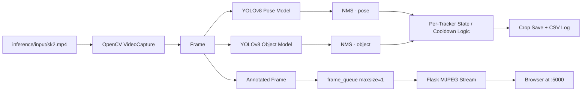

# Inference System Documentation

## 1. System Overview

This system is a real-time exam-cheating detection pipeline built on YOLOv8. It processes a single exam-room video file, runs pose estimation and object detection in parallel on each frame, tracks persons and objects across frames using Ultralytics built-in tracking (`persist=True`), and accumulates per-tracker temporal state to trigger "evidence" crop saves when a cheating-related detection persists long enough.

**Input:** a single video file from `inference/input/` (mp4, avi, mkv, mov, webm). Currently only `sk2.mp4` is present.

**Models:**
- Pose model (`pose-70s.pt`) — classifies person postures into three labels: `no-cheating`, `provide-object`, `see-friends-work`
- Object model (`v8s-object.pt`) — detects two objects: `smartphone`, `calculator`

**Major processing stages per frame:**
1. OpenCV reads a frame
2. Pose model tracks + classifies (imgsz=640, conf≥0.3, IoU=0.45)
3. Custom NMS deduplicates overlapping pose boxes
4. Object model tracks + detects (same settings)
5. Custom NMS deduplicates overlapping object boxes
6. Per-tracker temporal state updated; if a saveable class is detected continuously for ≥5 seconds, an expanded crop is saved to disk and a CSV row is written
7. Annotated frame pushed to a single-slot queue consumed by the Flask MJPEG stream

**Outputs:**
- Per-class evidence crops under `inference/output/pose/<class>/` and `inference/output/object/<class>/`
- Full-frame snapshots every 15 seconds under `inference/output/frames/`
- A room-view snapshot of frame 1 under `inference/output/room-view/`
- Per-day CSV log at `inference/YYYY-MM-DD_detection_log.csv`
- Plain-text detection log at `inference/detection_log.txt`
- Live MJPEG stream via Flask at `http://<host>:5000/`

**Real-time vs. offline:** The system is real-time in the sense that it processes frames as fast as the hardware allows while simultaneously serving live annotated frames to a browser. It is not a live camera system — the source is always a local video file.



## 2. Project Structure

```
inference/
├── main.py                      # entry point: bootstrap, threading, Flask
├── requirements.txt            # pip dependencies
├── __init__.py                 # package root marker
├── README.md                   # human-facing run/setup overview
├── PROJECT_DOCUMENTATION.md    # this file
├── detection_log.txt           # plain-text log (rewritten each run)
├── 2026-10-01_detection_log.csv# per-day CSV logs (never overwritten, appended)
├── 2026-10-02_detection_log.csv
├── config/
│   ├── __init__.py             # re-exports Config and path constants
│   ├── constants.py           # Config class: all thresholds, class lists, colors, timers
│   └── paths.py               # root-anchored path resolution + model/video discoverers
├── core/
│   ├── __init__.py            # re-exports CheatingDetectionPipeline
│   ├── nms.py                 # apply_nms() — standalone IoU-based NMS
│   └── pipeline.py            # CheatingDetectionPipeline — all detection/tracking/state logic
├── utils/
│   ├── __init__.py            # re-exports all utility functions
│   ├── image.py               # expand_crop, is_valid_crop, save_crop
│   ├── logging.py             # log_info() — console + optional file dual output
│   └── csv_log.py            # init_csv_log, log_detection_to_csv, get_csv_log_filename
├── web/
│   ├── __init__.py            # re-exports build_app
│   └── app.py                 # build_app() — Flask routes / and /video_feed
├── input/
│   └── sk2.mp4                # single exam-room video (the only supported input)
├── models/
│   ├── pose-70s.pt            # YOLOv8 pose model (3 classes)
│   └── v8s-object.pt          # YOLOv8 object detection model (2 classes)
├── output/
│   ├── frames/                # full-frame snapshots every 15 s
│   ├── room-view/             # frame-1 room snapshot
│   ├── pose/provide-object/   # pose evidence crops (currently empty)
│   ├── pose/see-friends-work/ # pose evidence crops
│   └── object/smartphone/     # object evidence crops
└── original_backup/
    └── main.py                # pre-refactor monolithic source (do not modify)
```

### Directory responsibilities

| Directory / File | Purpose | Part of main flow? |
|---|---|---|
| `main.py` | Orchestrates everything: bootstrap, path resolution, pipeline creation, thread start, Flask start | Yes — entry point |
| `config/paths.py` | Resolves all filesystem paths anchored to `INFER_ROOT`; discovers input video and model files | Yes — called by `main.py` and `Config` |
| `config/constants.py` | `Config` class holding all thresholds, class lists, colors, timers | Yes — passed to pipeline constructor |
| `core/pipeline.py` | All frame-loop, model-inference, NMS, tracking-state, crop-save, CSV-write logic | Yes — core |
| `core/nms.py` | `apply_nms()` — called by both `detect_pose` and `detect_objects` | Yes |
| `utils/image.py` | `expand_crop`, `is_valid_crop`, `save_crop` | Yes — called by pipeline |
| `utils/logging.py` | `log_info(msg, log_file, print_to_console)` | Yes — called throughout |
| `utils/csv_log.py` | `init_csv_log()`, `log_detection_to_csv()`, `get_csv_log_filename()` | Yes — called by pipeline and main |
| `web/app.py` | `build_app(pipeline)` returns a Flask app with two routes | Yes — called by `main.py` |
| `original_backup/main.py` | Legacy monolithic version; contains no code called by the current system | No — reference only |

## 3. Entry Points and Execution

### Primary entry point

`main.py` — launched from the `inference/` directory with `python main.py`.

### Execution sequence (in order)

```
python main.py
  │
  ├─ 1. sys.path bootstrap
  │     INFER_DIR  = os.path.dirname(os.path.abspath(__file__))
  │     PARENT_DIR = dirname(INFER_DIR)
  │     PARENT_DIR inserted at sys.path[0]
  │     → makes "inference" importable as a package
  │
  ├─ 2. Package imports resolve
  │     from inference.config import Config, paths as _paths
  │     from inference.utils import log_info
  │     from inference.utils.csv_log import init_csv_log
  │     from inference.core import CheatingDetectionPipeline
  │     from inference.web import build_app
  │
  ├─ 3. log_info("[INFO] Initializing cheating detection pipeline")
  │
  ├─ 4. config = Config()
  │     Config() has no __init__; uses class-level constants only
  │
  ├─ 5. pipeline = CheatingDetectionPipeline(config, video_path, pose_model_path, object_model_path)
  │     └─ setup_directories()   → creates all output/ subdirs
  │     └─ initialize_models()   → loads pose + object YOLO models (GPU/CPU auto-select)
  │
  ├─ 6. pipeline.frame_queue = queue.Queue(maxsize=1)
  │     pipeline.stop_event    = threading.Event()
  │
  ├─ 7. init_csv_log()
  │     Creates today's CSV file with header if it does not already exist
  │
  ├─ 8. log_file = open(_paths.DETECTION_LOG_TXT, "w")
  │     Truncates detection_log.txt to empty
  │
  ├─ 9. processing_thread = threading.Thread(target=pipeline.process_video, args=(log_file,))
  │     processing_thread.daemon = True
  │     processing_thread.start()
  │     → video loop runs in background; inference starts immediately
  │
  └─10. app = build_app(pipeline)
       app.run(host='0.0.0.0', port=5000, threaded=True)
       → blocks the main thread; Flask serves MJPEG stream
       → on KeyboardInterrupt: pipeline.stop_event.set() → processing_thread.join()
```

### Secondary entry points

`original_backup/main.py` is a standalone legacy monolith. It has its own `if __name__ == "__main__"` block and would run if invoked directly, but it is not imported by any part of the current system and uses hardcoded absolute paths (`C:\Users\ardut\projects\...`). It is **not part of the primary execution path**.

## 4. Module-by-Module Responsibilities

| Module | Responsibility | Important Functions/Classes | Called By | Calls/Depends On |
|---|---|---|---|---|
| `main.py` | System bootstrap: `sys.path` setup, config instantiation, pipeline construction, thread launch, Flask start | `main()` | CLI (`python main.py`) | `inference.config`, `inference.utils`, `inference.core`, `inference.web` |
| `config/paths.py` | Root-anchored path resolution; discovers input video and model files at runtime | `resolve_input_video()`, `resolve_pose_model()`, `resolve_object_model()`, module-level constants (`INFER_ROOT`, `INPUT_DIR`, `MODELS_DIR`, `OUTPUT_DIR`, etc.) | `main.py` (video/model paths), `Config` class (output paths), `utils/csv_log.py` (CSV path) | `os` only; no internal imports |
| `config/constants.py` | Frozen configuration: all detection thresholds, class lists, colors, timers, crop scales | `Config` class (no methods; pure constants) | `CheatingDetectionPipeline.__init__` | `config/paths` (for output path constants) |
| `core/pipeline.py` | All frame-loop logic: video reading, model inference, NMS, tracker state management, cooldown checks, crop saving, CSV writing, MJPEG frame generation | `CheatingDetectionPipeline` (methods: `process_video`, `process_frame`, `detect_pose`, `detect_objects`, `process_detection`, `display_results`, `generate_frames`, `setup_directories`, `initialize_models`) | `main.py` | `cv2`, `ultralytics.YOLO`, `core/nms.apply_nms`, `utils/image`, `utils/logging`, `utils/csv_log` |
| `core/nms.py` | Standalone IoU-based NMS; deduplicates overlapping detections within a single frame before downstream logic | `apply_nms(boxes, scores, iou_threshold)` → list of kept indices | `CheatingDetectionPipeline.detect_pose` and `.detect_objects` | `numpy` only |
| `utils/image.py` | Crop expansion (bounding-box dilation), brightness validation, disk write | `expand_crop()`, `is_valid_crop()`, `save_crop()` | `core/pipeline.py` | `cv2`, `numpy`, `os` |
| `utils/logging.py` | Dual-output timestamped logging (console + optional file handle) | `log_info(msg, log_file=None, print_to_console=True)` | All modules that produce log lines | `datetime` only |
| `utils/csv_log.py` | Per-day CSV detection log: file init, filename resolution, row append | `init_csv_log()`, `log_detection_to_csv()`, `get_csv_log_filename()` | `main.py` (init), `core/pipeline.py` (row writes) | `csv`, `config/paths` |
| `web/app.py` | Flask app factory: injects pipeline reference, defines two routes | `build_app(pipeline)` → Flask app | `main.py` | `flask`, `cv2` |

## 5. End-to-End Execution Flow

The following traces one run of `python main.py` with `sk2.mp4` in `input/`.

```mermaid
sequenceDiagram
  participant M as main.py
  participant P as CheatingDetectionPipeline
  participant C as cv2.VideoCapture
  participant POSE as pose-70s.pt
  participant OBJ as v8s-object.pt
  participant NMS as core/nms.py
  participant W as Flask /video_feed

  M->>P: CheatingDetectionPipeline(config, video_path, pose_model_path, object_model_path)
  P->>P: setup_directories() → creates output/ subdirs
  P->>POSE: YOLO(pose_model_path, task='pose')
  P->>OBJ: YOLO(object_model_path, task='detect')
  M->>P: pipeline.frame_queue = Queue(maxsize=1)
  M->>P: pipeline.stop_event = threading.Event()
  M->>P: processing_thread.start() → P.process_video(log_file)

  loop Each frame (until video ends or stop_event set)
    P->>C: cap.read() → (success, frame)
    P->>P: frame_idx += 1, timestamp computed
    P->>P: if 15s elapsed → save full frame to output/frames/
    P->>POSE: pose_model.track(frame, conf=0.3, iou=0.45, persist=True, imgsz=640)
    POSE-->>P: results with boxes.xyxy, boxes.cls, boxes.id, boxes.conf
    P->>NMS: apply_nms(all_boxes, all_scores, 0.45)
    NMS-->>P: keep_indices
    P->>P: for each kept pose box: draw expanded rect + label; if class in SAVE_POSE_CLASSES → process_detection()
    P->>OBJ: object_model.track(frame, conf=0.3, iou=0.45, persist=True, imgsz=640)
    OBJ-->>P: results with boxes.xyxy, boxes.cls, boxes.id, boxes.conf
    P->>NMS: apply_nms(all_boxes, all_scores, 0.45)
    NMS-->>P: keep_indices
    P->>P: for each kept object box: draw rect + label; if class in SAVE_OBJECT_CLASSES → process_detection()
    P->>P: FPS + frame counter drawn on annotated frame
    P->>P: frame_queue.put(annotated.copy())  [non-blocking, maxsize=1]
    P->>P: display_results() → cv2.imshow if DISPLAY set
    W->>P: generate_frames() → queue.get(timeout=1) → cv2.imencode → yield MJPEG chunk
  end
  P->>P: cap.release(), cv2.destroyAllWindows(), log_file.close()
```

### Step-by-step description

1. **Input discovery.** `main.py` calls `_paths.resolve_input_video()`. This scans `inference/input/` for the first file (sorted alphabetically) whose extension is `.mp4`, `.avi`, `.mkv`, `.mov`, or `.webm`. If no file is found, it returns the sentinel string `input/<missing-video>` and `cv2.VideoCapture` will fail to open it.
2. **Model discovery.** `resolve_pose_model()` scans `inference/models/` for `.pt` files. It prefers a file whose name contains `"pose"`; `resolve_object_model()` prefers one containing `"object"`. If no preferred file matches, the first `.pt` file found is used as a fallback.
3. **Pipeline construction.** `CheatingDetectionPipeline.__init__` creates all output subdirectories (`output/frames`, `output/room-view`, `output/pose/provide-object`, `output/pose/see-friends-work`, `output/object/smartphone`) and loads both YOLO models.
4. **Video loop start.** `process_video` opens `cv2.VideoCapture` and requests 640×640. The loop reads frames in order, processing each fully before moving to the next.
5. **Per-frame processing.** Each frame passes through `process_frame` which: (a) saves a room-view snapshot on frame 1 only; (b) runs `detect_pose`; (c) runs `detect_objects`; (d) overlays FPS and frame counter; (e) returns the annotated frame.
6. **Evidence save check.** `process_detection` is called for every pose or object detection whose class is in the respective `SAVE_*` list. It updates the per-tracker dict and may save a crop + CSV row.
7. **MJPEG stream.** The annotated frame is pushed to `frame_queue` (maxsize=1). Flask's `generate_frames` generator pulls from the queue and encodes JPEG.
8. **Termination.** When `cap.read()` returns `(False, None)` (end of video) or `stop_event` is set (Ctrl-C or `q` key), the loop exits, resources are released, and `log_file` is closed.

## 6. AI / Computer Vision Pipeline

Both models are YOLOv8 variants loaded via the `ultralytics` Python package. No TensorRT, no ONNX export, no CUDA-specific flags are set in the code — Ultralytics auto-selects the best available device (CUDA if available, else CPU).

### 6.1 Pose Pipeline

| Property | Value |
|---|---|
| Model file | `inference/models/pose-70s.pt` |
| Framework | Ultralytics YOLOv8 (`task='pose'`) |
| Inference call | `pose_model.track(source=frame, conf=0.3, iou=0.45, persist=True, imgsz=640)` |
| Input | raw BGR frame (640×640 as requested by `cv2.VideoCapture` property settings) |
| Output | `results[0].boxes` — attributes: `xyxy` (xyxy float tensor), `cls` (int tensor), `id` (int tensor, from built-in BoT-SORT), `conf` (float tensor) |
| Classes | 0 = `no-cheating`, 1 = `provide-object`, 2 = `see-friends-work` |
| Saveable classes | `provide-object`, `see-friends-work` (i.e. any pose that is not `no-cheating`) |
| Crop scale for evidence | 2.5× (POSE_SAVE_CROP_SCALE) |
| Crop scale for display | 1.5× (DISPLAY_CROP_SCALE) |

```
Frame
 ↓
pose_model.track(conf=0.3, iou=0.45, persist=True, imgsz=640)
 ↓
results[0].boxes  (xyxy, cls, id, conf)
 ↓
apply_nms(all_boxes, all_scores, iou_threshold=0.45)
 ↓
for each kept detection:
  draw expanded pose box + label "ID:<track_id> <class_name> <conf>"
  if class_name in SAVE_POSE_CLASSES:
    process_detection(track_id, class_name, x1,y1,x2,y2, frame, ...)
```

### 6.2 Object Detection Pipeline

| Property | Value |
|---|---|
| Model file | `inference/models/v8s-object.pt` |
| Framework | Ultralytics YOLOv8 (`task='detect'`) |
| Inference call | `object_model.track(source=frame, conf=0.3, iou=0.45, persist=True, imgsz=640)` |
| Input | raw BGR frame (640×640) |
| Output | `results[0].boxes` — attributes: `xyxy`, `cls`, `id`, `conf` |
| Classes | 0 = `smartphone`, 1 = `calculator` |
| Saveable classes | `smartphone` only (calculators are detected and drawn but never saved as evidence) |
| Crop scale for evidence | 4.5× (OBJ_SAVE_CROP_SCALE) |

```
Frame
 ↓
object_model.track(conf=0.3, iou=0.45, persist=True, imgsz=640)
 ↓
results[0].boxes  (xyxy, cls, id, conf)
 ↓
apply_nms(all_boxes, all_scores, iou_threshold=0.45)
 ↓
for each kept detection:
  draw object box + label "ID:<track_id> <class_name> <conf>"
  if class_name in SAVE_OBJECT_CLASSES:
    process_detection(track_id, class_name, x1,y1,x2,y2, frame, ...)
```

### 6.3 NMS (core/nms.py)

`apply_nms(boxes, scores, iou_threshold)` is a standard greedy IoU-based NMS. It:
1. Converts lists to numpy arrays
2. Computes box areas as `(x2-x1+1) * (y2-y1+1)`
3. Sorts detection indices by score descending
4. Iteratively keeps the highest-scored box and removes all boxes whose IoU with it exceeds `iou_threshold` (0.45)
5. Returns a list of integer indices to keep

The NMS threshold (0.45) is the same as the `iou` argument passed to `pose_model.track` and `object_model.track`. This means the model's internal NMS runs first (during inference), and the custom NMS runs a second time on the output boxes before display and state logic.

## 7. Configuration System

All configuration is in the `Config` class in `config/constants.py`. There are no environment variables read at runtime (except `DISPLAY`, checked in `display_results`). No YAML/JSON config files. No command-line arguments.

| Configuration | Location | Purpose | Used By |
|---|---|---|---|
| `POSE_CLASSES` | `Config` | List of pose class names (display only; actual class IDs come from model) | pipeline (class name lookup) |
| `OBJECT_CLASSES` | `Config` | List of object class names (display only) | pipeline |
| `SAVE_POSE_CLASSES` | `Config` | Which pose classes trigger evidence crop saves: `provide-object`, `see-friends-work` | `detect_pose` → `process_detection` |
| `SAVE_OBJECT_CLASSES` | `Config` | Which object classes trigger evidence crop saves: `smartphone` only | `detect_objects` → `process_detection` |
| `CONF_THRESH_POSE` (0.3) | `Config` | Minimum confidence for pose detections | `pose_model.track(conf=...)` |
| `CONF_THRESH_OBJ` (0.3) | `Config` | Minimum confidence for object detections | `object_model.track(conf=...)` |
| `NMS_IOU_THRESHOLD` (0.45) | `Config` | IoU threshold for both model inference NMS and custom `apply_nms` | `pose_model.track(iou=...)`, `object_model.track(iou=...)`, `apply_nms` |
| `DISPLAY_CROP_SCALE` (1.5) | `Config` | Box dilation factor for pose display rectangles (wider than raw box for context) | `detect_pose` (display only, not evidence) |
| `POSE_SAVE_CROP_SCALE` (2.5) | `Config` | Box dilation factor for pose evidence crops | `process_detection` (pose path) |
| `OBJ_SAVE_CROP_SCALE` (4.5) | `Config` | Box dilation factor for object evidence crops | `process_detection` (object path) |
| `MIN_CROP_BRIGHTNESS` (30) | `Config` | Minimum mean grayscale brightness for a crop to be considered valid; crops darker than this are rejected | `is_valid_crop` |
| `POSE_COOLDOWN` (90 s) | `Config` | Minimum seconds between two evidence saves for the same pose track_id | `process_detection` (pose path) |
| `OBJECT_COOLDOWN` (90 s) | `Config` | Minimum seconds between two evidence saves for the same object track_id | `process_detection` (object path) |
| `REQUIRED_DETECTION_TIME` (5 s) | `Config` | A tracker must have been continuously detected for at least 5 s before the first evidence crop is saved | `process_detection` |
| `FRAME_SAVE_INTERVAL` (15 s) | `Config` | Full-frame snapshot cadence in seconds | `process_video` loop |
| `POSE_BOX_THICKNESS` / `OBJECT_BOX_THICKNESS` / `TEXT_THICKNESS` (all 1) | `Config` | cv2 drawing thicknesses | `detect_pose`, `detect_objects`, `process_frame` |
| `POSE_COLORS` / `OBJECT_COLORS` | `Config` | BGR color per class for drawing | `detect_pose`, `detect_objects` |
| `OUTPUT_POSE_BASE`, `OUTPUT_OBJ_BASE`, `OUTPUT_FULLROOM`, `OUTPUT_FRAMES` | `Config` (from `config/paths`) | Output directory paths | `setup_directories`, frame/room-view saves, `process_detection` |

## 8. Path and File Management

### Root resolution

`config/paths.py` derives `INFER_ROOT` at module-import time:

```python
_INFER_PARENT = os.path.dirname(os.path.abspath(__file__))   # .../inference/config
INFER_ROOT    = os.path.dirname(_INFER_PARENT)                # .../inference
```

All other paths are built from `INFER_ROOT`, so the system is CWD-independent.

| Path constant | Value |
|---|---|
| `INPUT_DIR` | `inference/input/` |
| `MODELS_DIR` | `inference/models/` |
| `OUTPUT_DIR` | `inference/output/` |
| `OUTPUT_POSE_BASE` | `inference/output/pose/` |
| `OUTPUT_OBJ_BASE` | `inference/output/object/` |
| `OUTPUT_FULLROOM` | `inference/output/room-view/` |
| `OUTPUT_FRAMES` | `inference/output/frames/` |
| `DETECTION_LOG_TXT` | `inference/detection_log.txt` |

### Input video discovery

`resolve_input_video()` scans `INPUT_DIR` for the first file (sorted) matching `.mp4`, `.avi`, `.mkv`, `.mov`, or `.webm`. If none found, returns `INPUT_DIR/<missing-video>` (a non-existent path that will cause `cv2.VideoCapture` to fail and the pipeline to log an error and return).

### Model discovery

`resolve_pose_model()` and `resolve_object_model()` scan `MODELS_DIR` for `.pt` files. They prefer a file whose name contains `"pose"` or `"object"` respectively; if no preferred match, the first `.pt` file found is used as fallback. If the `models/` directory does not exist, a sentinel `<missing-...>` path is returned.

### Output directory creation

`setup_directories()` (called in `CheatingDetectionPipeline.__init__`) creates all output subdirectories with `os.makedirs(exist_ok=True)` before the video loop starts. This includes per-class subdirectories (`output/pose/provide-object/`, `output/pose/see-friends-work/`, `output/object/smartphone/`) so that evidence crops have a destination ready.

## 9. Input System

- **Accepted formats:** `.mp4`, `.avi`, `.mkv`, `.mov`, `.webm` (lowercase extension check via `name.lower().endswith(...)`)
- **Selection:** `resolve_input_video()` picks the alphabetically-first matching file in `inference/input/`. Multiple videos are not supported in parallel — only one is discovered and processed per run.
- **No input present:** The function returns `inference/input/<missing-video>`. `cv2.VideoCapture` fails to open it; `process_video` logs `[ERROR] Could not open video file` and returns immediately. No crash; the Flask server continues running.
- **Frame reading:** `cap.read()` is called once per loop iteration. OpenCV requests 640×640 via `cap.set(cv2.CAP_PROP_FRAME_WIDTH/HEIGHT, 640)`. The source video (`sk2.mp4`) reports 30 FPS.
- **FPS handling:** No explicit frame-skipping or decimation. All frames are processed at whatever rate the hardware allows. The source video FPS is logged but not used to throttle.
- **End-of-video:** When `cap.read()` returns `(False, None)`, the loop breaks and processing ends cleanly.
- **Error handling:** A failure to open the video is caught and logged; the pipeline thread exits without raising. No retry logic.

## 10. Output System

| Output | Location | Format | Producer | Purpose |
|---|---|---|---|---|
| Per-class evidence crops | `inference/output/pose/<class>/` and `inference/output/object/smartphone/` | JPEG, named `{track_id}_{class}_{conf:.2f}_{HHMMSS}.jpg` | `process_detection` via `save_crop` | Visual evidence of cheating behavior; one crop per triggered event |
| Full-frame snapshots | `inference/output/frames/` | JPEG, named `frame_{HHMMSS}_{frame_idx}.jpg` | `process_video` loop (every 15 s) | Periodic full-room reference frames |
| Room-view snapshot | `inference/output/room-view/` | JPEG, named `room_{HHMMSS}.jpg` | `process_frame` (frame 1 only) | Initial room layout reference |
| Detection log (txt) | `inference/detection_log.txt` | Plain text, one line per log call: `[HH:MM:SS.mmm] [INFO/ERROR] message` | `log_info` throughout; file opened with mode `"w"` at start of `main()` | Per-run audit trail; truncated each run |
| Detection log (CSV) | `inference/YYYY-MM-DD_detection_log.csv` | CSV, header: `ID, Filename, Jenis Kecurangan, Confidence Score, Waktu Deteksi` | `log_detection_to_csv` in `process_detection` | Per-day rolling evidence log; never truncated within a day, appended |
| Live MJPEG stream | `http://<host>:5000/video_feed` | multipart/x-mixed-replace JPEG frames | `generate_frames` generator → Flask | Real-time annotated video in browser |

### CSV row format (synthetic example)

```
ID,Filename,Jenis Kecurangan,Confidence Score,Waktu Deteksi
4,4_see-friends-work_0.88_131601.jpg,see-friends-work,0.88,2026-10-02 13:16:01
3,3_smartphone_0.62_131601.jpg,smartphone,0.62,2026-10-02 13:16:01
```

## 11. State, Timing, Threading, and Concurrency

### Threads

- **Main thread:** Runs `app.run()` (Flask). Blocks until Ctrl-C.
- **`processing_thread` (daemon):** Runs `pipeline.process_video(log_file)`. Owns the entire video loop, model inference, NMS, state tracking, crop saves, and CSV writes. Daemon threads do not prevent process exit.
- **Flask worker threads:** `app.run(threaded=True)` allows concurrent requests; each `/video_feed` request gets its own thread running the `generate_frames` generator.

### Shared state (no locks)

| Variable | Owned by | Read by | Written by | Notes |
|---|---|---|---|---|
| `pipeline.frame_queue` | `main.py` | `process_video` (put), `generate_frames` (get) | Both | `queue.Queue(maxsize=1)`; `put` is non-blocking (`block=False`), so a full queue silently drops the frame |
| `pipeline.stop_event` | `main.py` | `process_video` loop, `generate_frames` loop | `main.py` (on Ctrl-C), `process_video` (on `q` keypress) | `threading.Event`; set → both loops exit |
| `pipeline.id_info_pose` | `pipeline` | `detect_pose`, `process_detection`, `display_results` | `process_detection` | Dict keyed by pose track_id |
| `pipeline.id_info_obj` | `pipeline` | `detect_objects`, `process_detection`, `display_results` | `process_detection` | Dict keyed by object track_id |

There are no explicit locks. `frame_queue` uses `queue.Queue` (thread-safe internally). The `id_info_*` dicts are only mutated by the single `processing_thread`, so no contention exists in practice.

### Per-tracker state dictionary

Each entry in `id_info_pose` or `id_info_obj` has the shape:

```python
{
    'first_time': datetime,   # when the tracker first appeared (or class changed)
    'last_saved': datetime or None,  # last time an evidence crop was saved
    'last_class': str,         # class name of the most recent detection
    'last_conf': float or None # confidence of the most recent detection
}
```

### Timing mechanism: REQUIRED_DETECTION_TIME + cooldown

`process_detection` implements a two-stage gate:

```
Tracker first seen (track_id not in id_info):
  → id_info[track_id] = {first_time: now, last_saved: None, last_class: cls, last_conf: conf}

Each subsequent frame for the same track_id:
  ┌─ last_saved is set AND (now - last_saved) < COOLDOWN (90 s)
  │   → return immediately (no save)
  │
  ├─ last_class != current class
  │   → reset first_time = now, update last_class
  │   (class change restarts the 5-second timer)
  │
  └─ last_class == current class AND (now - first_time) >= REQUIRED_DETECTION_TIME (5 s)
      → save crop + CSV row
      → last_saved = now
      → after 90 s cooldown expires, next qualifying frame saves again
```

The 5-second requirement means a transient 1-frame detection never triggers a save. The 90-second cooldown prevents the same person from generating evidence crops more than once per minute and a half.

## 12. Web / Dashboard System

The web layer is minimal. `web/app.py` exposes a single factory function `build_app(pipeline)` that returns a configured Flask app. There are no templates directory, no static files, and no API beyond two routes.

| Endpoint | Method | Behavior |
|---|---|---|
| `GET /` | HTML | Returns a minimal page with a single `` tag. The image tag auto-submits the `/video_feed` request continuously (MJPEG keeps the connection open). |
| `GET /video_feed` | MJPEG stream | Returns `pipeline.generate_frames()` with `mimetype='multipart/x-mixed-replace; boundary=frame'`. The generator blocks on `frame_queue.get(timeout=1)` for up to 1 second per chunk. |

**Shared state between inference and web:** The only bridge is `pipeline.frame_queue` (a `queue.Queue` of size 1) and `pipeline.stop_event`. The Flask thread reads; the processing thread writes. There is no direct variable sharing beyond the pipeline object reference passed to `build_app`.

```
Processing thread          Flask worker thread
(processing_thread)        (per browser request)
       │                            │
       │  frame_queue.put()        │  frame_queue.get(timeout=1)
       │  (annotated frame copy)   │  (blocking up to 1 s)
       └──────────────────────────► │
                                    │  cv2.imencode('.jpg', frame)
                                    │  yield MJPEG chunk
                                    ▼
                               Browser 
```

**Server configuration:** `host='0.0.0.0'`, `port=5000`, `threaded=True`. The server blocks the main thread; the processing thread runs concurrently.

## 13. Logging and Error Handling

### Console logging

Every `log_info` call with `print_to_console=True` (the default) prints a timestamped line to stdout. Timestamp format: `HH:MM:SS.mmm` (millisecond precision, truncated to 3 digits).

### File logging

`detection_log.txt` is opened in write mode (`"w"`) at the start of each run, so it is truncated every time. All `log_info` calls that receive a `log_file` handle write to it. The file is closed at the end of `process_video`.

### CSV logging

CSV files are per-day and are **never truncated** — `init_csv_log` only writes the header if the file does not yet exist. `log_detection_to_csv` appends one row per triggered evidence save. This means the CSV accumulates across multiple runs on the same day.

### Exception handling

- **Video open failure:** `cap.isOpened()` is false → `[ERROR]` logged → `process_video` returns. No exception raised.
- **Queue full on `frame_queue.put`:** caught with `except queue.Full: pass` — the frame is silently dropped.
- **Queue empty in `generate_frames`:** `except queue.Empty: continue` — the generator sleeps 1 s and retries.
- **KeyboardInterrupt:** caught in `main()` → `stop_event.set()` → `processing_thread.join()`.
- **`cv2.imshow` in `display_results`:** guarded by `if not os.environ.get('DISPLAY'): return`. On headless Linux servers, `DISPLAY` is unset so no window is shown. On Windows, `DISPLAY` is typically unset but `cv2.imshow` may still work depending on the OpenCV build.
- **Unhandled cases:** If a model file is missing or corrupt, `YOLO(...)` raises an exception in `initialize_models` and the entire process crashes (no try/except around model loading). If `input/` contains a file but it is not a valid video, `cv2.VideoCapture` silently fails to open (handled). There is no retry or fallback for model loading failures.

## 14. External Dependencies

| Dependency | Used For | Important Modules |
|---|---|---|
| `ultralytics` (YOLOv8) | Model loading (`YOLO(...)`), inference via `.track()`, built-in BoT-SORT tracking (`persist=True`) | `core/pipeline.py` |
| `opencv-python` (`cv2`) | Video capture, frame reading, image encoding (`imencode`), drawing (`rectangle`, `putText`, `imshow`), grayscale conversion, image writing | `core/pipeline.py`, `web/app.py`, `utils/image.py` |
| `numpy` | NMS array operations (`argsort`, `where`, array indexing), brightness computation (`np.mean`) | `core/nms.py`, `utils/image.py` |
| `flask` | Web server, routes, `render_template_string`, `Response` with multipart MIME type | `web/app.py`, `main.py` |
| `threading` | Background processing thread (`processing_thread`), `stop_event` | `main.py` |
| `queue` | `frame_queue` (maxsize=1) bridging inference to Flask; thread-safe | `main.py`, `core/pipeline.py` |
| `csv` | CSV log read/write | `utils/csv_log.py` |
| `os` | Path construction, `makedirs`, `listdir`, `getenv` | All modules |
| `time` / `datetime` | Timestamps, FPS computation, cooldown timing, `REQUIRED_DETECTION_TIME` checks | `core/pipeline.py`, `utils/logging.py` |

> **Note:** `requirements.txt` lists `cv2` and `numpy` explicitly, but these are installed as part of `opencv-python` (cv2) and as a dependency of `ultralytics` (numpy). The file is not a complete or version-pinned dependency list — no version numbers are specified.

## 15. Data Flow

```
sk2.mp4
  ↓ cv2.VideoCapture.read()
ndarray frame (H×W×3, BGR, uint8, 640×640)
  ├─► pose_model.track(frame) → results[0].boxes (xyxy, cls, id, conf tensors)
  │     ↓ apply_nms
  │     list of kept indices
  │     ↓ per-kept-detection loop
  │     (track_id, class_name, x1,y1,x2,y2, conf)
  │     ↓ process_detection()
  │     id_info_pose[track_id] updated (dict)
  │     ↓ if 5 s + 90 s cooldown met
  │     ndarray crop (expanded BGR sub-array) → JPEG via cv2.imwrite
  │     CSV row (track_id, filename, class, conf, timestamp)
  │
  └─► object_model.track(frame) → results[0].boxes (xyxy, cls, id, conf tensors)
        ↓ apply_nms
        list of kept indices
        ↓ per-kept-detection loop
        (track_id, class_name, x1,y1,x2,y2, conf)
        ↓ process_detection()
        id_info_obj[track_id] updated (dict)
        ↓ if 5 s + 90 s cooldown met
        ndarray crop (expanded BGR sub-array) → JPEG via cv2.imwrite
        CSV row (track_id, filename, class, conf, timestamp)

annotated ndarray (frame + boxes + labels + FPS text)
  ↓ frame_queue.put(annotated.copy())
  ↓ generate_frames() → cv2.imencode('.jpg')
  ↓ MJPEG multipart stream
Browser 
```

The two model pipelines are fully independent of each other — they share the same input frame and write to separate `id_info` dicts, but there is no cross-model association logic (e.g. no "person holding phone" merge).

## 16. Important Algorithms and Business Logic

### 16.1 Pose class filtering for saves

`SAVE_POSE_CLASSES = ["provide-object", "see-friends-work"]`. The `no-cheating` class is detected, drawn, and tracked, but never triggers an evidence save. This means a person sitting normally produces no output files.

### 16.2 Object class filtering for saves

`SAVE_OBJECT_CLASSES = ["smartphone"]`. Calculators are detected and drawn but are excluded from evidence saving. Only smartphones trigger crop saves and CSV rows.

### 16.3 REQUIRED_DETECTION_TIME (5 s) gate

A tracker must have been continuously detected under the same class for at least 5 real-time seconds before the first evidence crop is saved. This prevents saving crops from brief, possibly false-positive detections. The timer is reset if the tracker's class changes (e.g. a person transitions from `provide-object` to `see-friends-work`).

### 16.4 COOLDOWN (90 s) gate

After an evidence crop is saved for a given `track_id`, no further crops for that tracker are saved for 90 seconds. This limits evidence volume and avoids redundant crops of the same continuous event.

### 16.5 Brightness validation

`is_valid_crop` converts the crop to grayscale and computes the mean. If the mean is below `MIN_CROP_BRIGHTNESS` (30), the crop is rejected and not saved. This filters out crops of very dark or occluded regions.

### 16.6 Custom NMS (second pass)

The YOLO model already runs internal NMS during inference. The custom `apply_nms` runs a second NMS pass on the surviving boxes before display and state logic. This is redundant in most cases but ensures that if the model's internal NMS was conservative, the custom NMS can tighten the threshold to 0.45 explicitly.

### 16.7 Frame save interval (15 s)

A full-frame JPEG is written to `output/frames/` every 15 wall-clock seconds (not 15 video frames). This provides periodic reference frames of the full room, independent of detection events.

### 16.8 Room-view snapshot (frame 1 only)

The very first frame of the video is saved as `room_<HHMMSS>.jpg` in `output/room-view/`. This captures the initial room layout before any annotations.

## 17. Execution / How to Run

**Working directory:** `inference/`

**Assumptions:**
- Python 3.8+ with `ultralytics`, `flask`, `opencv-python`, `numpy` installed
- Both model files present: `inference/models/pose-70s.pt` and `inference/models/v8s-object.pt`
- At least one video file in `inference/input/` (e.g. `sk2.mp4`)

**Install dependencies:**
```bash
pip install -r inference/requirements.txt
```

**Run:**
```bash
cd inference
python main.py
```

**Expected behavior on startup:**
1. Console prints initialization messages
2. Models load (may take several seconds on CPU; near-instant on GPU)
3. Video loop begins; Flask server starts on port 5000
4. Open a browser to `http://localhost:5000/` to see the live MJPEG stream
5. Press `q` in the cv2 window (if a display is available) or Ctrl-C to stop

**Outputs after a run:**
- New or appended rows in `inference/YYYY-MM-DD_detection_log.csv`
- New files in `inference/output/frames/`, `inference/output/room-view/`, and per-class evidence directories
- Rewritten `inference/detection_log.txt`

## 18. Runtime Scenario

The following traces what happens when a user runs the system with `sk2.mp4` (a 30 FPS exam-room video) and a person in the room is detected performing `see-friends-work` for more than 5 seconds.

1. **Program starts.** `python main.py` is invoked from the `inference/` directory.
2. **Paths resolve.** `resolve_input_video()` returns `inference/input/sk2.mp4`. `resolve_pose_model()` returns `inference/models/pose-70s.pt`. `resolve_object_model()` returns `inference/models/v8s-object.pt`.
3. **Config instantiated.** `Config()` is created; all class-level constants are available.
4. **Pipeline constructed.** `CheatingDetectionPipeline.__init__` creates output subdirectories and loads both YOLO models. `setup_directories` confirms `output/pose/see-friends-work/` exists.
5. **CSV log initialized.** `init_csv_log()` creates or confirms `inference/2026-10-03_detection_log.csv` (today's date).
6. **detection_log.txt opened.** Truncated to empty.
7. **Processing thread starts.** `pipeline.process_video(log_file)` begins in a background daemon thread.
8. **Flask server starts.** `app.run(host='0.0.0.0', port=5000, threaded=True)` blocks the main thread. Browser at `http://localhost:5000/` begins receiving MJPEG frames.
9. **Frame 1 processed.** `cv2.VideoCapture` reads the first frame. `room_<HHMMSS>.jpg` is saved to `output/room-view/`. Pose and object models run. No saveable class detected yet; `id_info_pose` and `id_info_obj` are populated with initial tracker entries.
10. **Frames 2–N (first 5 seconds).** Person `track_id=4` is consistently classified as `see-friends-work` (conf ~0.88). `id_info_pose[4]['first_time']` was set on the first detection. No crop is saved yet because `(now - first_time) < 5 s`.
11. **5-second threshold met.** On a frame where `(now - first_time) >= 5 s` and `last_saved` is `None`, `process_detection` expands the bounding box at 2.5× scale, crops the frame, checks brightness (≥30), and writes `output/pose/see-friends-work/4_see-friends-work_0.88_<HHMMSS>.jpg`. A row is appended to the CSV. `id_info_pose[4]['last_saved']` is set to `now`.
12. **Next 90 seconds.** `process_detection` for `track_id=4` returns immediately on every frame because `(now - last_saved) < 90 s`. No further crops.
13. **90-second cooldown expires.** If `see-friends-work` is still detected for `track_id=4`, the next qualifying frame triggers another crop save and CSV append.
14. **Full-frame snapshots.** Every 15 wall-clock seconds, a full-frame JPEG is written to `output/frames/`.
15. **Browser stream.** Throughout, the Flask `/video_feed` endpoint pushes annotated frames (with pose/object boxes, labels, FPS counter) to the browser in real time.
16. **Video ends.** `cap.read()` returns `(False, None)`. The processing loop exits. `cap.release()`, `cv2.destroyAllWindows()`, and `log_file.close()` are called. The `generate_frames` generator detects `stop_event` is set (or the queue stays empty) and stops yielding.
17. **Process ends.** Ctrl-C in the terminal → `stop_event.set()` → `processing_thread.join()` → clean exit.

## 19. Architectural Observations

The following are factual observations about the current implementation. No redesign is proposed.

### FACT: Single video input assumption
`resolve_input_video()` returns exactly one path. The system processes one video file per run. There is no loop over multiple input files.

### FACT: Two independent model pipelines, no cross-association
Pose and object detections are processed in separate code paths with separate `id_info` dicts. There is no logic that links "person track_id X" with "object track_id Y" to produce a combined event (e.g. "person X holding smartphone Y").

### FACT: `no-cheating` pose class is tracked but never saved
The pose model outputs three classes. `no-cheating` boxes are drawn on the annotated frame and tracked in `id_info_pose`, but because `no-cheating` is not in `SAVE_POSE_CLASSES`, no evidence crop or CSV row is ever produced for it.

### FACT: Calculator objects are tracked but never saved
`calculator` is in `OBJECT_CLASSES` and is detected and drawn, but it is not in `SAVE_OBJECT_CLASSES`, so no evidence crop is saved for calculator detections.

### FACT: `frame_queue` silently drops frames when full
`frame_queue` has `maxsize=1` and `put` is called with `block=False`. If the Flask consumer is slower than the inference producer (e.g. network stall), frames are dropped without warning. There is no back-pressure mechanism.

### OBSERVATION: `original_backup/main.py` is unused legacy code
This file is not imported by any module in the current system. It contains hardcoded absolute Windows paths and would fail if run on a different machine. It serves only as a reference to the pre-refactor monolith.

### OBSERVATION: No try/except around model loading
If either `.pt` file is missing or corrupt, `YOLO(...)` raises an unhandled exception in `initialize_models` and the process crashes. There is no graceful fallback.

### OBSERVATION: `cv2.VideoCapture` frame-size request may be ignored
`cap.set(cv2.CAP_PROP_FRAME_WIDTH, 640)` and `cap.set(cv2.CAP_PROP_FRAME_HEIGHT, 640)` are called, but OpenCV backends (especially FFmpeg) do not always honor these requests. The actual frame size depends on the source video. The `imgsz=640` argument to `track()` ensures the model internally resizes to 640 regardless.

### OBSERVATION: `detection_log.txt` is truncated every run
Because it is opened with mode `"w"`, each run overwrites the previous run's log. The CSV log, by contrast, is appended to within the same day. This means the plain-text log reflects only the most recent run, while the CSV reflects all runs on that day.

### OBSERVATION: `DISPLAY` env var check for `cv2.imshow`
`display_results` returns early if `os.environ.get('DISPLAY')` is falsy. On Windows, `DISPLAY` is typically unset, so the cv2 window is never shown — the system is effectively headless on Windows unless `DISPLAY` is explicitly set.

### OBSERVATION: `requirements.txt` is not version-pinned
The file lists package names without version constraints. `cv2` and `numpy` are listed but are transitive dependencies of `opencv-python` and `ultralytics` respectively. The `flask` entry appears twice.

## 20. Quick Reference

| Item | Value |
|---|---|
| **Main entry point** | `inference/main.py` |
| **Run command** | `cd inference && python main.py` |
| **Input video** | `inference/input/sk2.mp4` (or any single `.mp4`/`.avi`/`.mkv`/`.mov`/`.webm` in `input/`) |
| **Pose model** | `inference/models/pose-70s.pt` (3 classes: no-cheating, provide-object, see-friends-work) |
| **Object model** | `inference/models/v8s-object.pt` (2 classes: smartphone, calculator) |
| **Core processing module** | `inference/core/pipeline.py` — `CheatingDetectionPipeline` |
| **NMS module** | `inference/core/nms.py` — `apply_nms` |
| **Config (thresholds/timers)** | `inference/config/constants.py` — `Config` class |
| **Path resolution** | `inference/config/paths.py` — `resolve_input_video`, `resolve_pose_model`, `resolve_object_model` |
| **Image utilities** | `inference/utils/image.py` — `expand_crop`, `is_valid_crop`, `save_crop` |
| **Logging** | `inference/utils/logging.py` — `log_info` |
| **CSV log** | `inference/utils/csv_log.py` — `init_csv_log`, `log_detection_to_csv` |
| **Web server** | `inference/web/app.py` — `build_app` (Flask, port 5000) |
| **Evidence crops (pose)** | `inference/output/pose/provide-object/`, `inference/output/pose/see-friends-work/` |
| **Evidence crops (object)** | `inference/output/object/smartphone/` |
| **Full-frame snapshots** | `inference/output/frames/` (every 15 s) |
| **Room-view snapshot** | `inference/output/room-view/` (frame 1 only) |
| **CSV log file** | `inference/YYYY-MM-DD_detection_log.csv` (appended, per-day) |
| **Plain-text log** | `inference/detection_log.txt` (truncated each run) |
| **Live stream URL** | `http://<host>:5000/` (MJPEG) |
| **Confidence threshold** | 0.3 (both pose and object) |
| **NMS IoU threshold** | 0.45 |
| **Required detection time** | 5 s |
| **Cooldown** | 90 s (both pose and object) |
| **Min crop brightness** | 30 (grayscale mean) |

